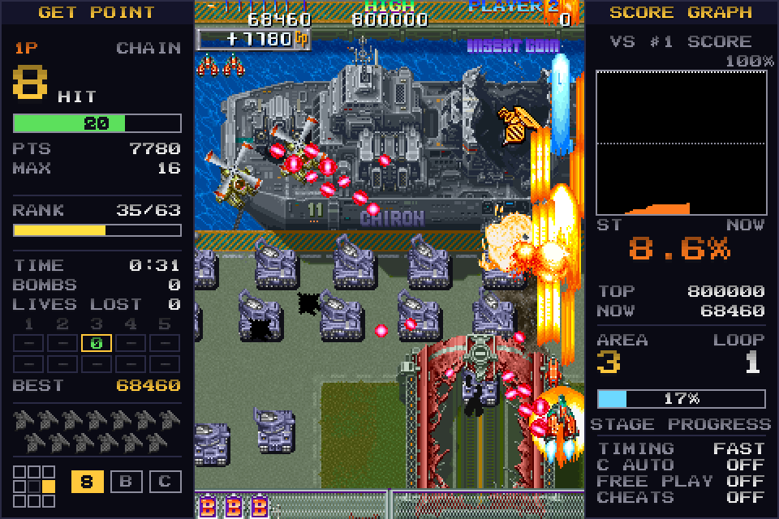
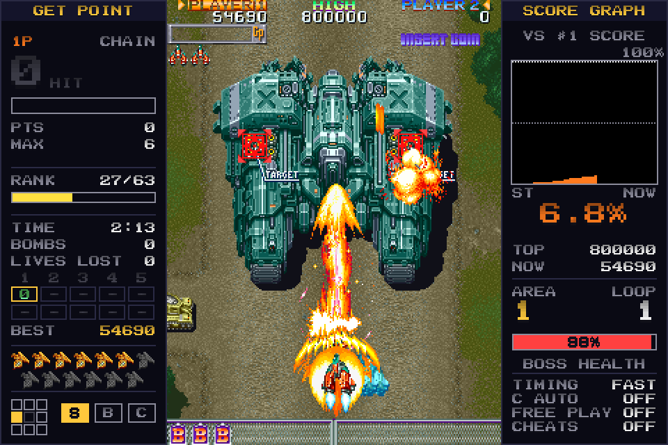
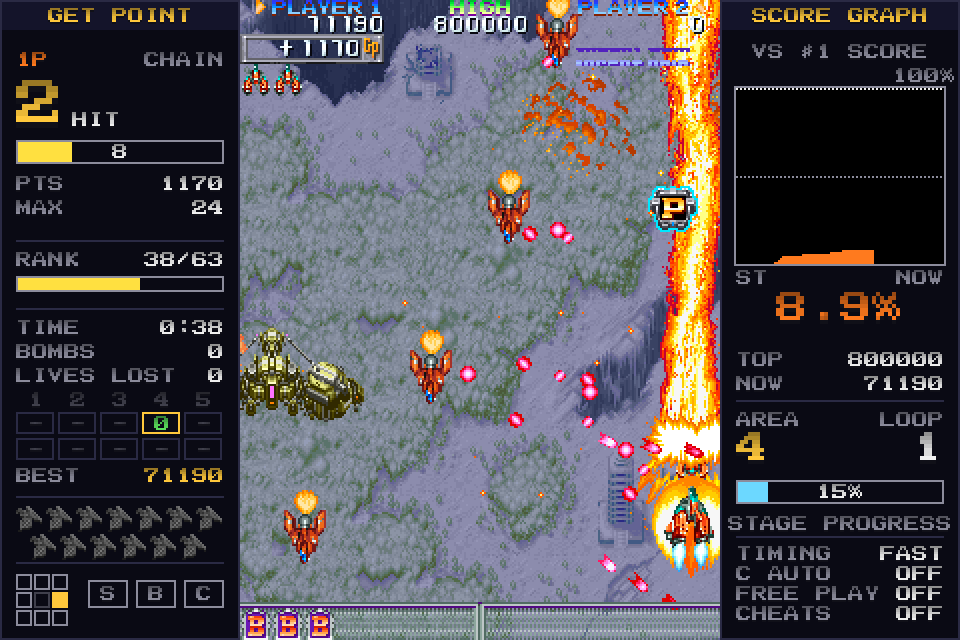
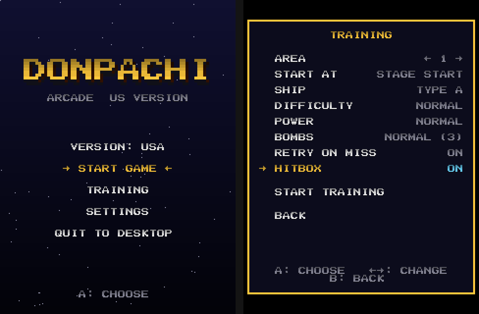

<p align="center"></p>

# DonPachi Recomp

*A huge thank you to [cheviman](https://github.com/cheviman), author of
[arcade-decomp](https://github.com/cheviman/arcade-decomp): without it, this project would never have started.*

A native Windows port of Cave's 1995 arcade shooter **DonPachi** (US version), made by decompiling the
arcade board's 68000 program into C and running it on a model of the Cave hardware. No emulator: the game's own logic
runs natively, frame for frame the same as the arcade original.

**This repository contains no game data.** You need your own copy of the arcade ROM set (MAME's `donpachi.zip`).
The game reads its graphics, sound and data from it.

## Screenshots

<p align="center">
  
  
</p>
<p align="center">
  
  
</p>

## Download and play

1. Get the latest `DonPachi-x.y.z-win64.zip` from [**Releases**](https://github.com/CapsLock4284/DonPachi-Recomp/releases/latest).
2. Unzip it somewhere you can write to (not inside *Program Files*) and run `donpachi.exe`.
   Windows may show *"Windows protected your PC"* because the program isn't signed: click **More info → Run anyway**.
3. On the first run a window asks for the ROM set: drag `donpachi.zip` onto it. The game extracts what it needs once
   (`donpachi_usa.dat`, beside the program); after that the .zip isn't needed. Merged and non-merged MAME sets both work.

**Cheats (optional):** the Cheats page (Settings > Game Options > Cheats) uses MAME's cheat file for DonPachi, which
isn't included. Take `donpachi.xml` out of MAME's `cheat.7z` (from [Pugsy's Cheats](https://www.mamecheat.co.uk)) and
put it in a `cheats` folder beside `donpachi.exe`, as `cheats\donpachi.xml`.

The release's `README.txt` has the controls, hotkeys and the list of files the game keeps. What's new in each
version: [CHANGELOG.md](CHANGELOG.md).

## Features

- **The arcade game, exactly:** checked frame by frame against MAME's 68000 core through both loops
- **Low input lag** by default, with the board's own timing as an option
- **Main menu** with **Training**: start at any area, its mid-boss, its boss or area 10's true boss, with your choice
  of ship, power (any level, or "on pace" for that point), bombs and difficulty, and retry on a miss
- **Side panels** on wide screens: chain (GP) gauge, rank, run statistics, bees collected, score graph against the
  top score, stage progress and boss and mid-boss health
- **Save states**, fast forward, hitbox display, high scores saved between sessions
- **23 achievements**, with a pop-up when one is earned (arcade games only: not training, cheats or save states)
- **Replays**: every arcade game (and training run) is recorded; save it as a small file you can share, and watch
  them from the main menu's REPLAYS, with pause and frame-by-frame stepping; rename or delete them there
- **Lifetime statistics**: games, play time, clears, bosses, deaths, bombs, bees, best chain and scores, per ship and
  per area (arcade games only)
- **Menu tooltips** on the side panel, explaining each option
- **Graphics:** scaling modes, smoothing, scanlines, vsync, TATE rotation, borderless or exclusive full screen
- **Game options:** difficulty, free play, the arcade's hidden big HIT display, the arcade's test menu, MAME cheats
- Keyboard and gamepads (Xbox layout, two players), everything remappable, settings in `donpachi.ini`

## Building from source

The decompiled C isn't in the repository (it comes from the ROM), so a build makes it from your own ROM set first.

**Needs:** Git, Python 3, CMake 3.20+, Visual Studio 2022 (C), and SDL2's development package
(`SDL2-devel-2.x.x-VC.zip` from [libsdl.org](https://github.com/libsdl-org/SDL/releases)).

```powershell
git clone --recursive https://github.com/CapsLock4284/DonPachi-Recomp.git
cd DonPachi-Recomp
# 1. your ROM set:            rom\donpachi.zip
# 2. SDL2's package unpacked: build\downloads\sdl2\SDL2-2.x.x\
python tools/decompile.py                       # writes src\ (the game's C) from the ROM
cmake -S . -B build/msvc
cmake --build build/msvc --config Release      # build\bin\donpachi.exe
```

`tools\make_release.ps1 -Version x.y.z` packages a release zip (an allow list of files, checked for anything from the
ROM before it zips).

## Project layout

| Folder | What's in it |
|---|---|
| `runtime/` | the board model: memory map, video (tile layers, sprites), sound (two OKI M6295s, NMK112), EEPROM, ROM set reader |
| `ports/sdl2/` | the Windows game: window, menus, settings, training, side panels, save states |
| `ports/headless/` | a windowless build for testing and frame-by-frame checks |
| `tools/` | the decompiler's game profile, analysis tools, the reference checker (`tools/cref`), packaging |
| `symbols.txt` | names for the program's functions and RAM (addresses and names only) |
| `TODO.md` | the plan, and notes on what's been found in the game |

`rom/`, `src/`, `assets/`, `build/`, `release/` and `*.dat` are git-ignored: anything derived from the ROM stays on
your own machine.

## Credits

- **DonPachi** is © 1995 Cave / Atlus. This is an unofficial fan project, not connected with or endorsed by them.
- The decompiler core is [arcade-decomp](https://github.com/cheviman/arcade-decomp) (in `tools/core`); the runtime and
  build follow tmntarcade-decomp's (Sebastian Toyos, BSD-3-Clause).
- The hardware model follows [MAME](https://github.com/mamedev/mame)'s Cave drivers (Luca Elia and the MAME team,
  BSD-3-Clause).
- [SDL2](https://www.libsdl.org/) (zlib license).
- Bee counts from the [shmups wiki](https://shmups.wiki/library/DonPachi).

## License

The project's own code is under the BSD 3-Clause license (see each file's header). The game itself is not included and
not covered by it.
